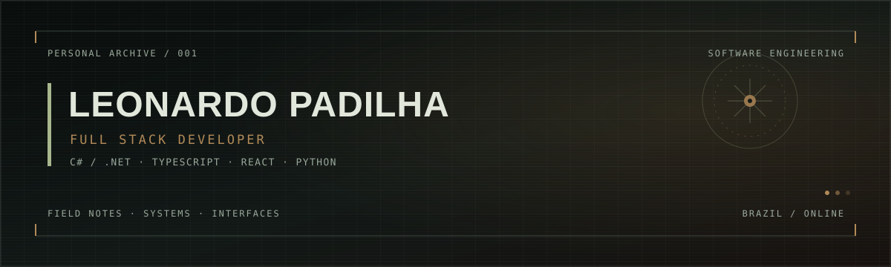

  

  <a href="https://www.leonardopadilha.com">PORTFÓLIO</a>
  &nbsp;·&nbsp;
  <a href="https://www.linkedin.com/in/leonardo-padilha-kawashaki/">LINKEDIN</a>
  &nbsp;·&nbsp;
  <a href="mailto:padilhakawashakil@gmail.com">EMAIL</a>

---

## Sobre

Desenvolvedor Full Stack com experiência na construção e evolução de aplicações web e mobile, APIs e integrações entre sistemas.

Trabalho entre frontend e backend, com atenção especial às partes que mantêm uma aplicação funcionando de ponta a ponta: modelagem de dados, autenticação, regras de negócio, comunicação em tempo real, integrações e manutenção.

Minha stack principal envolve **C#/.NET, TypeScript, React e SQL**. Também desenvolvo com Node.js, Python e Flutter.

Atualmente, estou aprofundando meus estudos em arquitetura de software, sistemas distribuídos, mensageria, observabilidade e engenharia backend.

## Tecnologias

**Frontend**

  

**Backend**

  

**Dados e infraestrutura**

  

**Outras experiências:** Flutter, Dart, SQL Server, SignalR, WebSockets, WebRTC, REST APIs e integrações de terceiros.

## Projetos em destaque

Projetos selecionados por representarem diferentes aspectos do meu trabalho: desenvolvimento full stack, APIs, automação, organização de dados e ferramentas de linha de comando.

### 01. [FinTrack](https://github.com/Padokazzz/FinTrack) · [Frontend](https://github.com/Padokazzz/fintrack-web)

C# · ASP.NET Core · EF Core · PostgreSQL · JWT · React · TypeScript

Aplicação de gestão financeira pessoal dividida entre uma API REST em .NET e uma interface React. O projeto explora separação de responsabilidades, autenticação, autorização por usuário, validação, persistência e integração entre frontend e backend.

### 02. [Portfolio](https://github.com/Padokazzz/Portfolio)

Next.js · React · TypeScript · Tailwind CSS · Playwright

Meu site pessoal, desenvolvido como um produto de conteúdo para reunir projetos, experiências, artigos técnicos e experimentos.

[Acessar o site](https://www.leonardopadilha.com)

### 03. [Job Hunter](https://github.com/Padokazzz/job-hunter)

TypeScript · Node.js · Fastify · Prisma · PostgreSQL · Docker

Ferramenta para coletar e organizar vagas de tecnologia de diferentes fontes, calcular compatibilidade com um perfil configurado e acompanhar oportunidades em um dashboard. A preparação de candidaturas fica sob controle humano.

### 04. [MTG Proxy Printer](https://github.com/Padokazzz/mtg-proxy-printer)

Python · Pillow · ReportLab · PyYAML · CLI

Ferramenta de linha de comando que transforma listas de cartas em PDFs para playtesting, com configuração por YAML, cache local de imagens e opções de impressão.

## No que estou trabalhando

- Aprofundamento em arquitetura de aplicações e sistemas distribuídos.
- Comunicação assíncrona com RabbitMQ e Kafka.
- Resiliência, observabilidade e testes de integração.
- Containers e automação de pipelines com CI/CD.

## Contato

- [leonardopadilha.com](https://www.leonardopadilha.com)
- [LinkedIn](https://www.linkedin.com/in/leonardo-padilha-kawashaki/)
- [padilhakawashakil@gmail.com](mailto:padilhakawashakil@gmail.com)

  Construindo sistemas. Investigando como as peças se conectam.

